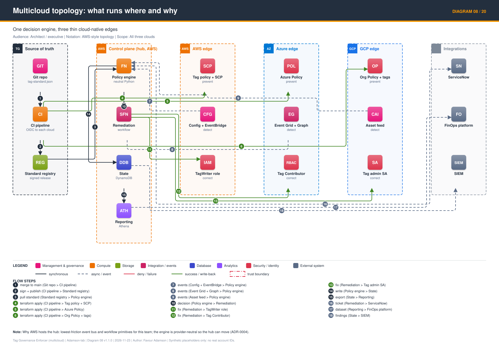

# Tag Governance Enforcer (multicloud)
**One tag standard, three clouds: prevent, detect and correct missing or invalid tags and labels across AWS, Azure and GCP.**
  

## Executive summary
Untagged or inconsistently tagged cloud resources make chargeback, incident routing and audit evidence unreliable. AWS tags, Azure tags and GCP labels have different rules, so teams drift. This project defines one versioned standard, a provider-neutral decision engine, and thin cloud-native edges, layered as prevent / detect / correct. It deliberately auto-fixes only deterministic things (alias, case, inheritance) and never guesses ownership.

## Business context
Stakeholders: CCoE, FinOps, Security/GRC, app teams, audit. Drivers: attributable spend, ownership, evidence. Constraints: GCP label charset, uneven tag-on-create support, least privilege. Success metrics: untagged spend < 5%, prod owner coverage >= 99%, detect < 5 min p95 (targets; see docs/01).

## Architecture at a glance

Standard in Git -> signed registry -> hub engine. Each cloud contributes a prevent edge (SCP/Policy/OrgPolicy), a detect edge (events + sweep) and a scoped writer. The engine returns COMPLIANT, AUTO_FIX, TICKET, ESCALATE, NOTIFY, EXPIRY_ENFORCE or EXEMPT. All 20 diagrams: `diagrams/index.html`, `docs/diagram-index.md`.

## Key design decisions
| Decision | Alternatives rejected | ADR |
|---|---|---|
| Lowercase kebab-case everywhere | native per-cloud styles | [0001](docs/04-adr/ADR-0001.md) |
| Prevent + detect + correct | any single layer | [0002](docs/04-adr/ADR-0002.md) |
| Hub engine + native prevention (supersedes native-only 0003) | per-cloud engines | [0004](docs/04-adr/ADR-0004.md) |
| Deterministic auto-fix only | guess owner | [0005](docs/04-adr/ADR-0005.md) |
| Never inherit data-classification | inherit all | [0006](docs/04-adr/ADR-0006.md) |
Full index: [docs/04-adr](docs/04-adr/README.md).

## Scope
In: tag/label standard, evaluation, correction plans, preventive policy, reporting feed. Out: resource lifecycle beyond stop/snapshot of expired sandbox, cost optimisation, CSPM. Assumptions: org-level access exists for read and tag-only write roles.

## Technology stack
Python 3.12 (pure engine, easy to test), Terraform (3 clouds, one IaC tool), OPA/Rego (CI gate), AWS EventBridge/SQS/Lambda/Step Functions/DynamoDB hub, Azure Policy/Event Grid/Logic Apps, GCP Asset feed/Pub/Sub/Workflows.

## Quick start (no cloud needed)
```bash
make test        # 15 unit tests
make sample      # evaluates examples/sample-inventory.json, writes evidence/sample-run.json
make diagrams    # regenerate the 20 SVG diagrams from code
make cost        # regenerate the cost model
make package     # builds dist/enforcer.zip for the Lambda module
```
Expected: `score=36.4%` on the synthetic sample (3 auto-fixable, 2 tickets, 1 escalation, 1 expiry enforcement, 1 exempt). Cleanup: `rm -rf dist`.

## Repository map
`src/tagenforcer` engine, adapters, remediation, handlers - `policies/` standard + OPA + native policies - `infra/` Terraform modules - `diagrams/` 20 diagrams as code - `docs/` full docs set - `evidence/` test and sample run outputs - `scripts/` packaging, cost model, GitHub upload.

## Non-functional targets
Detect p95 < 5 min; RTO 60 min / RPO 5 min; remediation success >= 99%; writers tag-only; hub cost < $100/month at 150k resources (modelled). All are targets until live evidence exists.

## Cost, security, operations, testing
[Cost model](docs/08-cost-and-finance/cost-model.md) - [Threat model](docs/06-security/threat-model.md) - [Runbooks and SLOs](docs/07-operations/runbooks.md) - [Test strategy](docs/10-testing/test-strategy.md) - [Risk register](docs/09-compliance-and-risk/risk-register.md).

## Trade-offs and known limitations (honest)
- **Not yet run live.** Terraform has not been applied or `terraform validate`d from this package; OPA tests have not been executed here (no `opa` binary); cloud API calls are plans only. CI workflows are included to produce that evidence.
- Native preventive controls do not cover every resource type; GCP custom constraints need lab validation.
- Auto-fix can collide with other automation that also writes tags (risk R-02).
- Cost figures use placeholder unit prices.
- Diagrams use automatic orthogonal routing; code verified every wire avoids every box, but I could only inspect geometry previews, not browser-rendered fonts. Densest diagram (08) has 18 flows: split it in `specs.py` if you want it lighter.

## Roadmap
Sandbox apply and evidence, Wave 1 detect-only, Infracost refresh, peer review. See [ROADMAP.md](ROADMAP.md).

## Contribute and contact
See [CONTRIBUTING.md](CONTRIBUTING.md). Maintainer: Favour Adamson, favouradamson803@gmail.com.

## License
MIT for code, CC BY 4.0 for docs and diagrams. Synthetic data only; no real account IDs, secrets or employer material.
